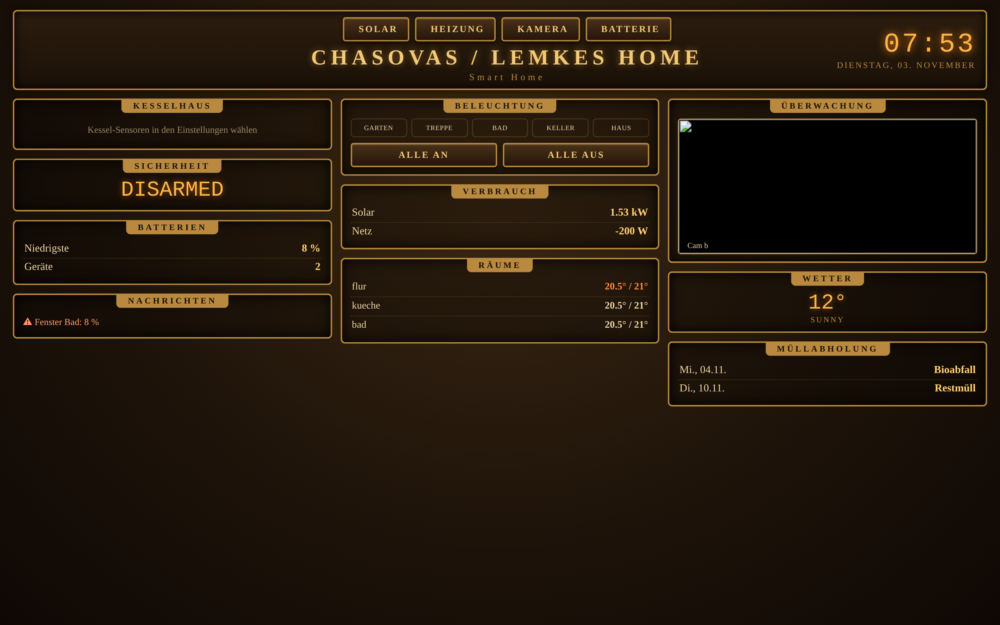
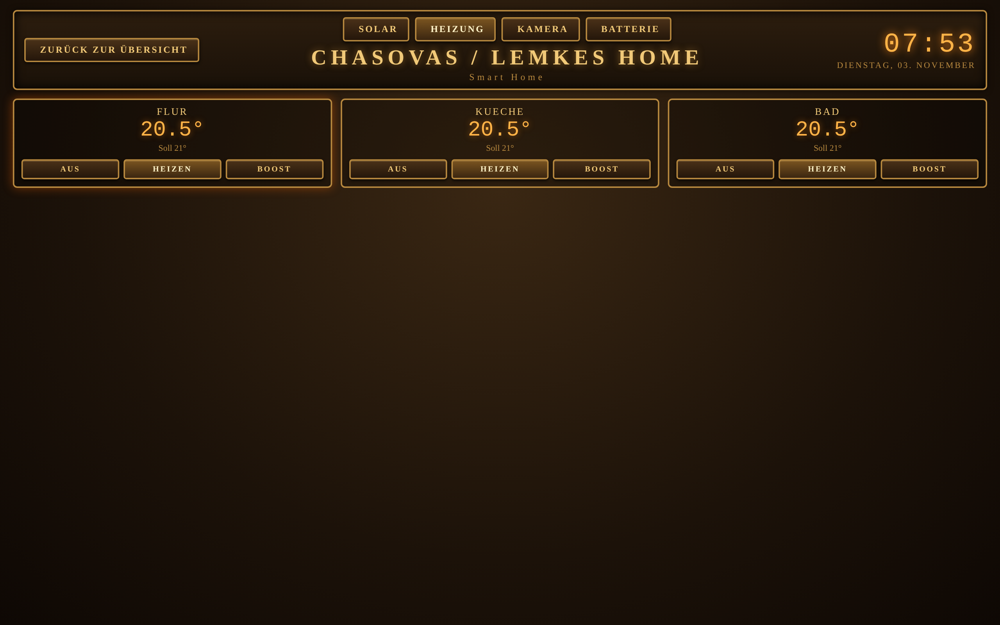
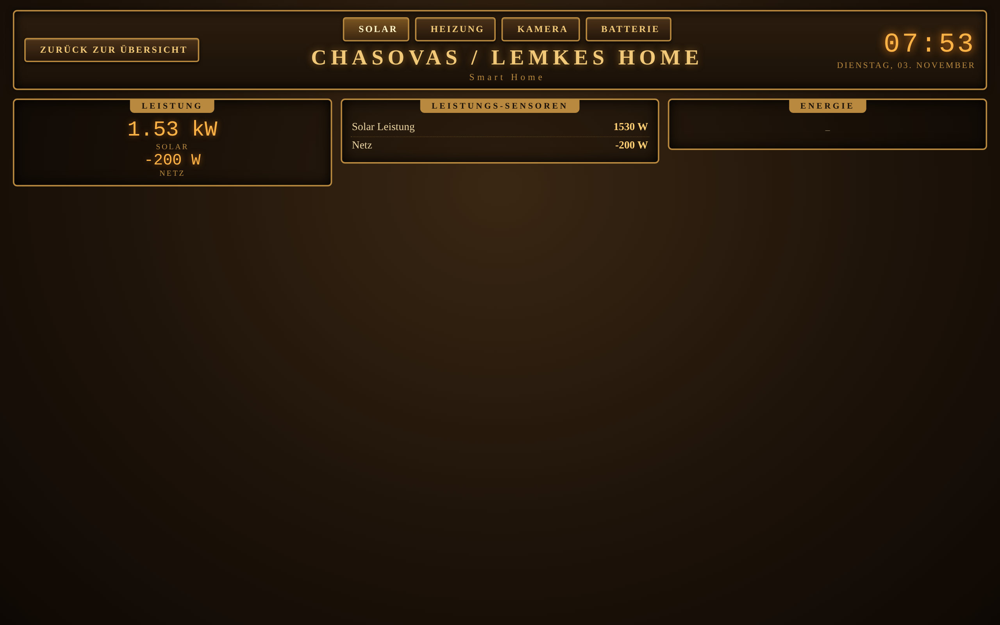
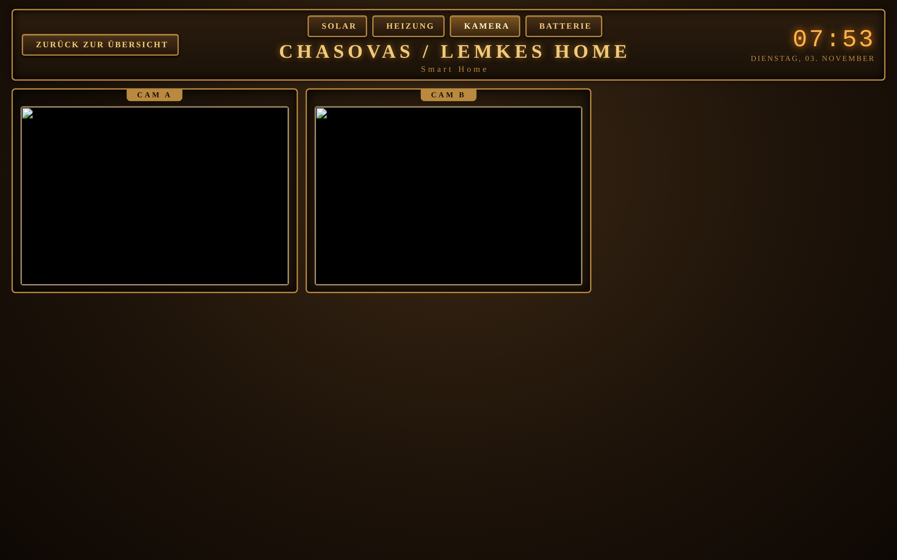
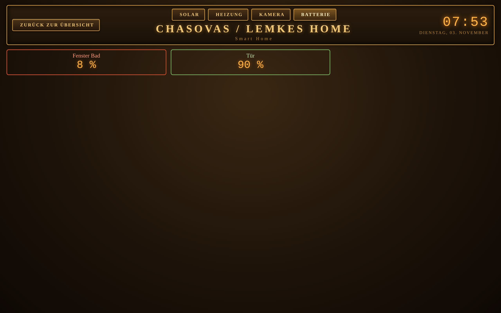

# Edison Dashboard (HACS)

Ein Smart-Home-Panel im Thomas-Edison-Stil (Messing, Glühlampen, Nixie-Uhr) für Home Assistant – optimiert für Wand-Tablets.

**Seiten:** Übersicht (3 Spalten), Solar, Heizung, Kamera, Batterie. Zurück-Button, Lichter einzeln und „Alle an/aus“, Kamera-Wechsel alle 2 Minuten, Zoom/Doppeltipp deaktiviert, automatische Skalierung auf die Bildschirmgröße.

## Bilder
*(Beispielansichten mit Demo-Daten)*

## Installation
1. HACS → ⋮ → *Benutzerdefinierte Repositories* → URL dieses Repos, Kategorie **Integration**.
2. „Edison Dashboard“ installieren, Home Assistant neu starten.
3. *Einstellungen → Geräte & Dienste → Integration hinzufügen → Edison Dashboard*.
4. Im Assistenten Titel wählen und Entitäten auswählen. **Alles ist optional – leer = automatische Erkennung** (Lichter, Thermostate, Kameras, Batterien, Wetter, Alarm …).
5. Es erscheint ein Eintrag in der Seitenleiste. Für Tablets: Option „Vollbild“ aktivieren oder die URL `/edison` im Kiosk-Browser öffnen.

Änderungen später: Integration → *Konfigurieren*.

## Optionen
Titel/Untertitel, Seitenleiste, Vollbild, Wetter, Solar-/Netzleistung, Kessel-/Vorlauf-Temperatur, Alarmanlage, Müll-Sensor (Attribute mit Datum, z. B. `2026-11-04: Bioabfall`), Lichter, Thermostate, Kameras, Batterien, Status-Sensoren, Boost-Skript (Feld `entity_id`; ohne Skript wird Preset `boost` gesetzt).

## Status
Version 0.1.0 – erste Version, getestet mit Mock-Daten, noch nicht in einer fremden HA-Installation. Rückmeldungen willkommen.
